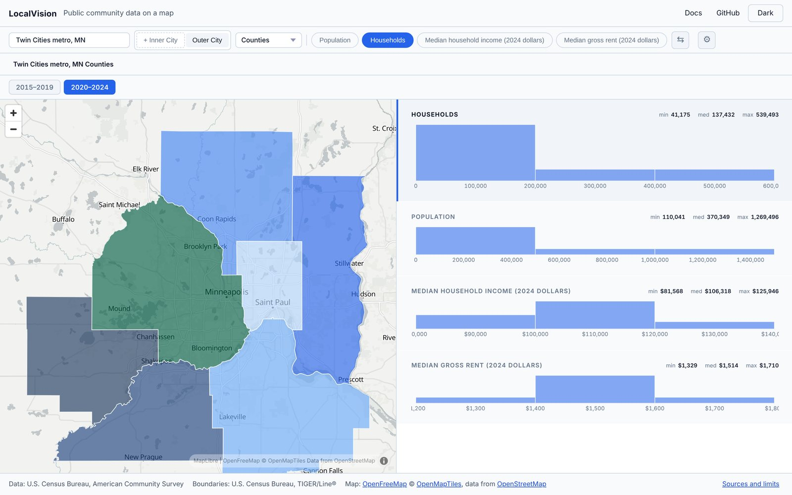

# LocalVision

**[Try the live demo →](https://mfaldet.github.io/localvision/)** Nothing to install. It works on a phone.

[](https://mfaldet.github.io/localvision/)

LocalVision puts public information about a community on a map. Pick any city in the United States and see how many people and households live there, what a typical household earns, and what rent costs, area by area. Switch between two periods to see what changed.

It is for people who watch a city's numbers and cannot pay for custom tools: city staff, nonprofits, researchers, students and small businesses. The figures come from the U.S. Census Bureau. The software is free and open source.

The demo shows four measures for two survey periods, 2015–2019 and 2020–2024. Its "Sources and limits" panel says where each figure comes from and what to be careful about.

## For developers

LocalVision is a TypeScript library: a choropleth map on US Census boundaries linked to KPI charts, from county down to block group.

**Docs:** https://mfaldet.github.io/localvision/docs/ · **Python/Jupyter wrapper:** [`python/`](python/)

Two views, one library. **Inner city** — how a single community varies inside itself (tracts, block groups, neighborhoods). **Outer city** — how a city compares to its peers (counties, places, subdivisions). Both bind ACS five-year data (with your own Census API key, or figures you save in advance as the demo does), drill down with breadcrumbs, animate over time, and keep their state in a shareable URL. Not everything planned is built: see [What works today](#what-works-today).

## Quick start

LocalVision is not published to npm. Get the code from GitHub:

```bash
git clone https://github.com/mfaldet/localvision.git
cd localvision
npm install
npm run dev        # serves the full demo, examples/acs-binding.html
```

To use it in a project of your own, build it once and install it from the folder you cloned:

```bash
npm run build                    # in the localvision folder: library → dist/
npm install ../localvision       # in your project: adjust the path to where you cloned it
```

```ts
import { LocalVisionApp, BoundaryLoader, CensusACS, bindDataToBoundaries } from 'localvision'

const loader = new BoundaryLoader({ persistentCache: true })
const acs    = new CensusACS({ apiKey: import.meta.env.VITE_CENSUS_API_KEY, sessionCache: true })

const [boundaries, table] = await Promise.all([
  loader.counties('27'),
  acs.fetchTemporal({
    variables: ['median_household_income', 'total_population', 'median_gross_rent'],
    geography: { state: '27', level: 'county' },
    years: [2018, 2019, 2020, 2021, 2022],
  }),
])

const binding = bindDataToBoundaries(boundaries, table)

new LocalVisionApp({
  container: '#app',
  boundaryContext: { stateFips: '27' },
  outer: { binding, activeKpi: 'median_household_income' },
  inner: { /* … */ },
  drillProvider: async ({ level, parent, context }) => { /* … */ },
})
```

`examples/acs-binding.html` is the developer example — city search, time slider, drill-down, styling controls — and needs a Census API key. `npm run dev` serves it. The live demo's own code is in [`demo/`](demo/); `npm run demo:dev` serves that, and it needs no key.

## What works today

This is an early project built by one person. The lists below come from running each feature in a browser in November 2026, not from the plan. The live demo hides the PNG export button and leaves out the OpenStreetMap layers because of the faults listed here.

**Works**

- US Census boundaries loaded from TIGERweb and cached: counties, places, county subdivisions, tracts and block groups
- City search across US places. Give it a saved list with populations, as the demo does, and the largest place of a name comes first
- Map and KPI panel linked one way: click an area on the map to see its figures; switch the measure to recolor the map
- Drill-down from a county into its tracts, with breadcrumbs back
- Time slider and animated playback, or a simple switch between a few periods
- Display settings: color scheme (including color-blind-safe palettes), opacity, boundary color, pattern and width, and a clip area
- Markers, drawn regions and lines, bookmarks and a bookmark tour, kept between visits
- Light and dark themes, on background maps from OpenFreeMap that need no key
- Shareable links that keep the city, view, level and period
- A phone layout
- Dashboard templates: equity, housing, economic, community
- 78 unit tests, run with a type check on every pull request

**Works, with known faults**

- ACS 5-year data binding needs your own Census API key. The Census API refuses requests without one, so the examples show no data until you add a key.
- Without a saved search list, city search loads the list from the Census boundary service state by state. That is slow on first load, and matches are not ranked by size.
- Boundaries for most places are fetched live from the Census boundary service. A large county can take ten seconds or more the first time, and nothing loads if that service is down.
- Margins of error are not shown anywhere, although every survey figure has one.
- PNG export fails in Chrome and downloads nothing. In comparison mode it saves only one of the two maps.
- Side-by-side comparison opens two maps. There is no swipe or difference view.
- OpenStreetMap layers (parks, schools, transit stops, hospitals) depend on the public Overpass servers and were not confirmed working in the last check.
- The Python / Jupyter wrapper installs and builds, but is not on PyPI and has not been checked inside a notebook.
- Keyboard navigation works, but charts have no screen-reader labels.

**Planned, not built**

- Clicking or brushing a chart to filter the map
- SVG and PDF export
- A grid-of-years view and year-over-year change
- A public call for adding your own map layers, and layer reordering
- A generated API reference and a gallery of examples
- Browser end-to-end tests and release automation

LocalVision is not published to npm or PyPI. See the [roadmap](ROADMAP.md) for the status of each planned piece.

## Docs

- [Getting started](docs/getting-started.md) — install and a first dashboard
- [Data binding](docs/data-binding.md) — bringing your own data
- [Boundaries](docs/boundaries.md) — the BoundaryLoader and caching
- [Styling](docs/styling.md) — themes, color schemes, line patterns
- [Python](docs/python.md) — Jupyter widget usage
- [Roadmap](ROADMAP.md)

## Layout

```
src/
├── data/        Data binding, ACS client, label cleaners
├── geo/         Census boundary loader (TIGERweb + static files), FIPS, spatial helpers
├── layers/      Custom map layer manager (Overpass / OSM presets)
├── state/       Stores (selection, drilldown, time)
├── theme/       Tokens (dark + light + CB-safe), CSS variables
├── views/       OuterCityView, InnerCityView, LocalVisionApp
├── templates/   Curated dashboard configs (equity, housing, etc.)
├── export/      PNG export + URL state encoding
└── index.ts     Public API
python/          Python wrapper (anywidget + pandas helpers)
examples/        Working HTML demos
docs/            Documentation site (VitePress)
```

## Development

```bash
npm install
npm run dev        # serves examples/acs-binding.html
npm run typecheck
npm test
npm run build      # library → dist/
```

The Python wrapper has its own setup — see [`python/README.md`](python/README.md).

## License

MIT — see [LICENSE](LICENSE).
